<div align="center">


# PHP Station

### The local PHP & Laravel workbench for Windows

**Every project on its own PHP version, Composer and MariaDB — side by side.**<br>
**Catch every email, `dump()` and error in one inbox. Undo a single bad query.**<br>
**Let your AI agent see it all (MCP). Know before you upgrade PHP or go live.**<br>
Free, open source, zero dependencies.

[](LICENSE)
[](#requirements)
[](#requirements)
[](package.json)
[](#features)
[](#features)

[Quick start](#quick-start) · [Features](#features) · [AI agents](#-ai-agents-claude-code-cursor-copilot-codex) · [Free AI](#-free-ai-built-in-chat-and-fix-with-ai-on-every-error) · [Upgrade Lab](#-upgrade-lab-will-it-run-on-php-85) · [Security scan](#-security-scan-before-you-go-live) · [Compared](#php-station-vs-xampp-vs-laragon) · [FAQ](#faq) · [Roman Urdu](#roman-urdu)

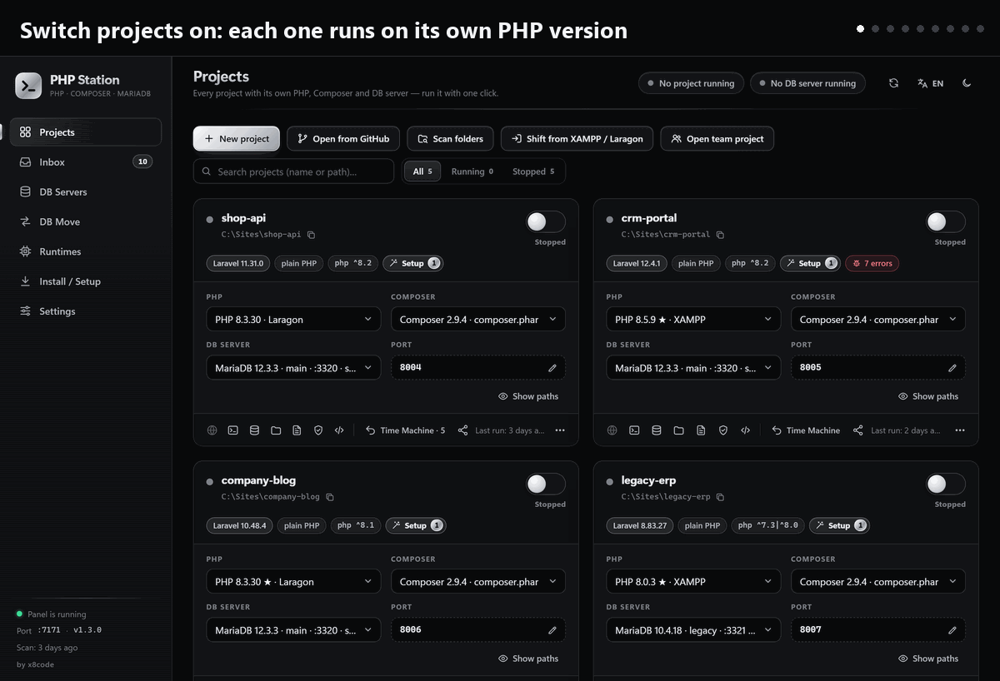

</div>

## Why PHP Station?

| The everyday pain | What PHP Station does |
|---|---|
| One project needs PHP 8.0, the next one PHP 8.3 | Each project runs on **its own `php.exe` and port, at the same time**. Nothing is switched globally. |
| A test email reached a real customer | The **Mail Catcher** keeps every email in the panel. Nothing is ever sent out. |
| `dd()` broke the page layout again | **`dump()` and `dd()` show up in the panel** as a neat tree, with the file:line that called them. |
| "Something went wrong" and a 40 MB `laravel.log` | **Errors are grouped**, new ones are flagged, and one click opens the line in VS Code. |
| A wrong `DELETE` or `migrate:fresh` | The **DB Time Machine** undoes that one query, or brings the whole database back. |
| "MySQL shutdown unexpectedly" in XAMPP | Clean shutdown on Windows sign-out, daily backups and **one-click repair**. |
| Setting up a teammate's repo takes an afternoon | **Paste a GitHub link**: clone, right PHP, `composer install`, `.env`, database, migrations, started. |
| Your AI agent can't see the OTP email, the `dd()` or `laravel.log`, and might wipe the database | **PHP Station speaks MCP.** Claude Code, Cursor, Copilot and Codex read the Inbox, save a restore point first and undo a bad write. |
| "Will this project still work on PHP 8.5?" | The **Upgrade Lab** runs the same project on both PHP versions and shows every package, file and page that breaks. |
| A leaked key or a `backup.sql` in `public/` goes live | The **Security scan** checks packages (`composer audit`), the code and the public folder before you deploy. |
| No budget for an AI subscription | **Free AI built in**: Gemini, Groq, OpenRouter, Mistral … one after the other, and a **Fix with AI** button on every error. |

## Quick start

1. **Download** the [latest ZIP](https://github.com/sami-hussain-dev/PHP-Station/archive/refs/heads/master.zip) and unzip it, or clone it:
   ```bash
   git clone https://github.com/sami-hussain-dev/PHP-Station.git
   ```
2. **Double-click `PHP-Station.bat`.** The panel opens as an app window at `http://127.0.0.1:7070/`.
   (No Node.js yet? It offers to download the portable LTS from nodejs.org. No admin rights needed.)
3. The **Setup wizard** shows what is on your PC and installs whatever your projects still need (PHP, MariaDB, Composer, phpMyAdmin) from the official sources.
4. Click **Shift from XAMPP / Laragon**, **Open from GitHub** or **+ New project**, then switch a project on.

That's it. A Desktop and Start Menu shortcut is created on the first start.

## Features

### 📬 Inbox: mail, dumps and errors in one place

Everything your app "says" while you build it, live, without changing a line of code or your `.env`.

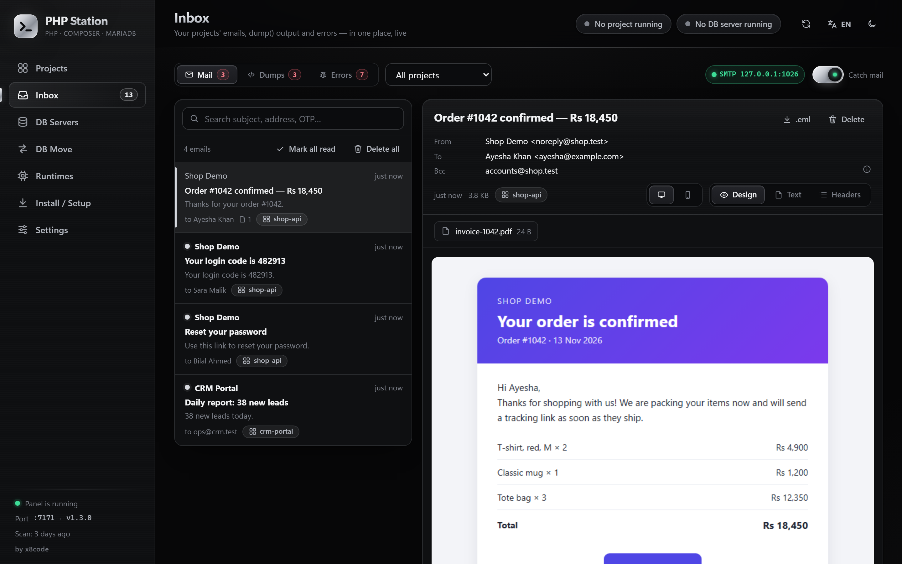

**Mail Catcher.** Every email a project sends while it runs in PHP Station (OTP codes, password resets, invoices, queued mail from `queue:work`) lands here instead of reaching real people. You can:
- see the real design in a desktop or mobile width, or switch to plain text or the raw headers;
- download attachments and the `.eml` file;
- spot Bcc recipients, which come from the SMTP envelope;
- see which project sent each email.

Nothing is ever relayed. The HTML is shown in a sandbox with scripts off.

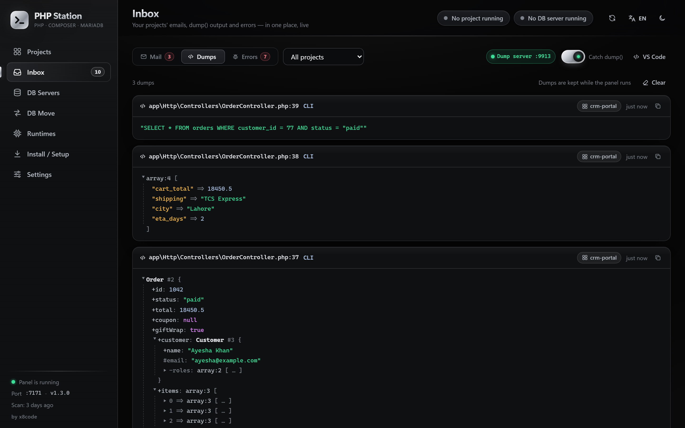

**Dumps.** `dump()` and `dd()` from Laravel / Symfony appear here as collapsible trees: objects, arrays, private and protected properties. Each dump carries its file:line, which opens in your editor, plus the URL and a copy button. The page itself stays clean. If the panel is closed, `dump()` prints into the page as before.

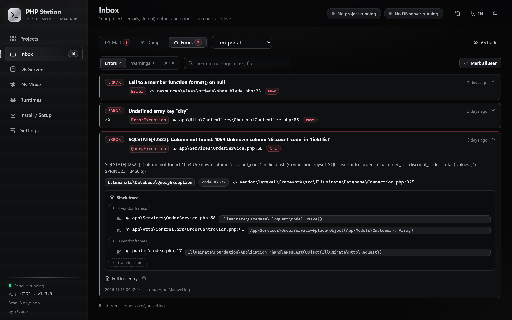

**Errors.** PHP Station reads `storage/logs/*.log` and the PHP server log of each project:
- the same error thrown 500 times becomes one row marked "×500";
- new errors are flagged, and the project card shows a red "3 errors" chip;
- the stack trace shows your own code first, with vendor frames folded;
- every file:line opens in **VS Code, Cursor, PhpStorm or Sublime**.

Your log files are only read, never changed.

<details>
<summary><b>How does it work without touching <code>.env</code>?</b></summary>

Projects started by PHP Station get a tiny `auto_prepend_file`. While the panel is running, it sets `MAIL_MAILER=smtp`, `MAIL_HOST=127.0.0.1` and `MAIL_PORT=1025` for that request only. Laravel's dotenv keeps values that already exist, so these win over `.env`. The same file sets `VAR_DUMPER_FORMAT=server`, Symfony's own switch that sends dumps to a dump server. When the panel is closed, the file does nothing at all.

Other apps can use the catcher too: set `MAIL_HOST=127.0.0.1` and `MAIL_PORT=1025`. Ports, on/off switches and the editor are on the Inbox page.
</details>

### 🤖 AI agents: Claude Code, Cursor, Copilot, Codex

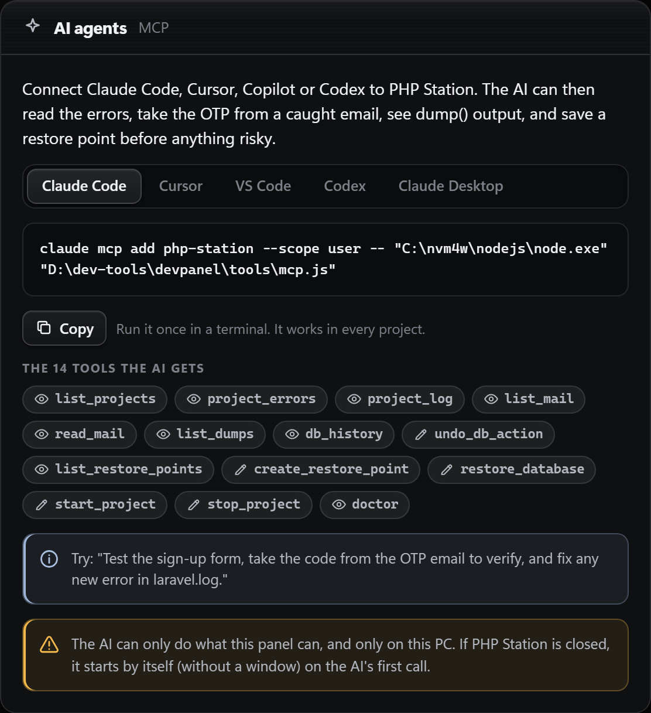

PHP Station is an **MCP server**, so your AI coding agent can see what your app really did, on this PC, without copying logs into the chat:

- **Errors** from `laravel.log`, grouped, with your own stack frames;
- **Caught emails**: the agent reads the OTP code or the password-reset link and finishes the flow it is testing;
- **`dump()` output**, the PHP server log and a health check;
- **Every INSERT / UPDATE / DELETE**, with **undo for one write**;
- **Restore points**: the agent saves one before `migrate:fresh` or a big `UPDATE`, and can go back.

Connect it once (**Settings → AI agents** shows the line for each tool):

```bash
claude mcp add php-station --scope user -- node "C:\PHP-Station\tools\mcp.js"
```

Then just ask: *"Test the sign-up form, take the code from the OTP email to verify, and fix any new error in laravel.log."*

The agent can only do what the panel can, and only on this PC. Tools that change something (restore, undo, start / stop) are marked, so your AI tool asks you first. If PHP Station is closed, it starts by itself without a window.

<br clear="right">

### ✨ Free AI built in: chat, and "Fix with AI" on every error

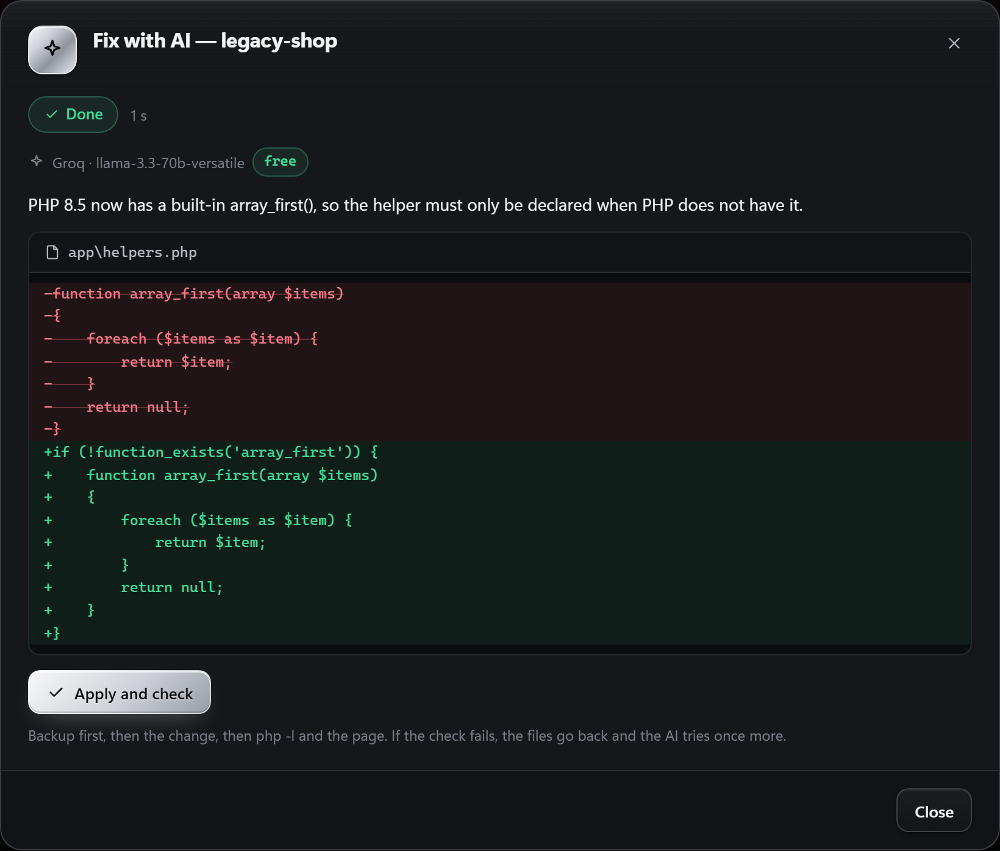

No AI subscription needed. PHP Station collects the **free tiers** of the big AI providers in one place and uses them one after the other:

- **Free first.** Google Gemini, Groq, OpenRouter (free models), Mistral, Cerebras and GitHub Models, each with **your own free key** (the card links to the page that gives it), plus **Ollama** on your own PC. Add your own paid account (OpenAI, Anthropic, DeepSeek or any OpenAI-compatible API) and it is used first.
- **Auto-switch, same conversation.** When Gemini's free limit for the day is used up, Groq answers the next message with the whole chat behind it, and the chat shows *"tried first: Google Gemini (daily limit)"*.
- **"Fix with AI" next to every error**: in the Inbox, the Upgrade Lab and the Security scan. The AI gets the error and the code around it, and answers with an exact change. You see the **diff** first. **Apply and check** backs up the files, applies the change, runs `php -l` (with the PHP version the error came from) and opens the page again. If the check fails, the files go back and the AI tries once more with what failed. **Undo** is always there.
- **Your data, your call.** Keys are encrypted with Windows DPAPI and never shown in full. `.env`, `vendor` and `storage` are never sent. Mark a project **"local AI only"** and its code only ever goes to Ollama on your PC.

| | |
|---|---|
| 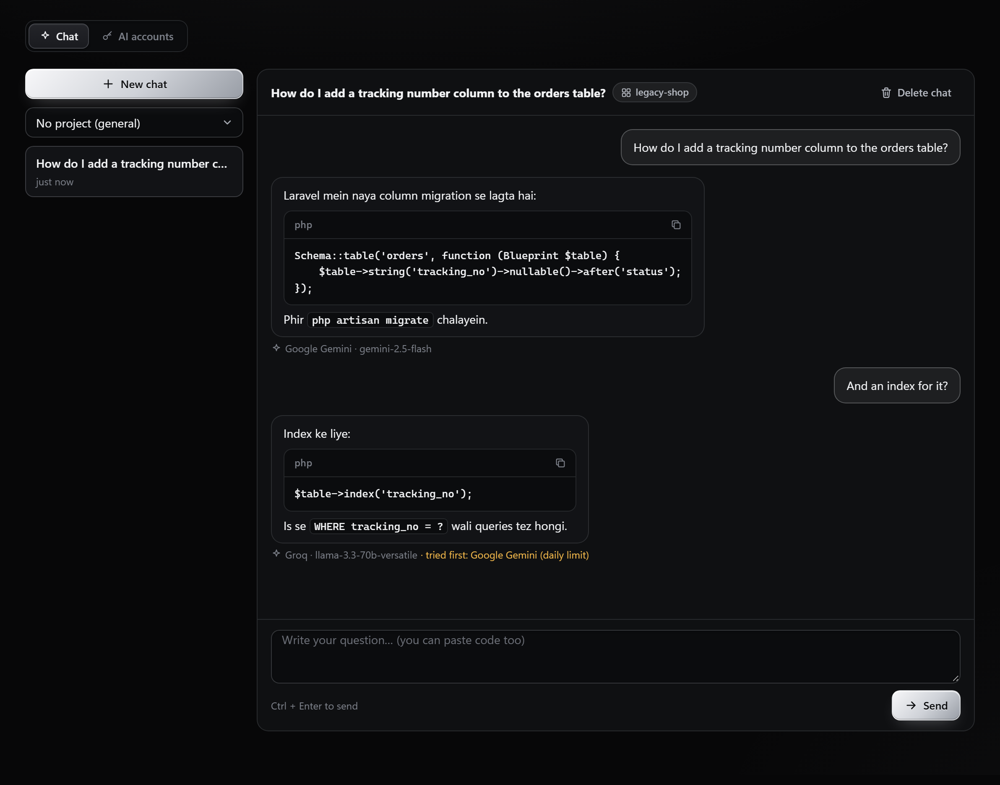 | 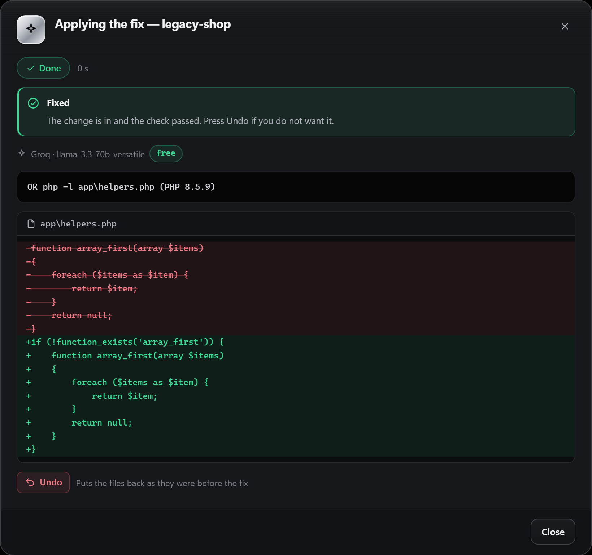 |
| **Chat** that carries on when one AI runs out | **Applied and checked**, one click to undo |

<details>
<summary><b>See the AI accounts page</b></summary>

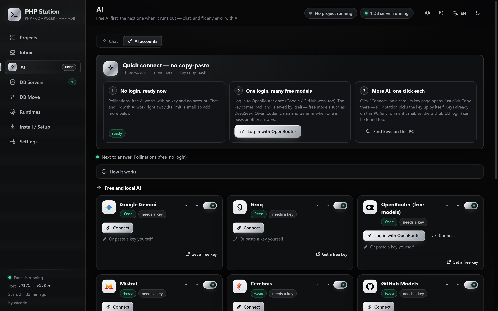
</details>

<sub>Free tiers have limits per minute and per day that the providers change from time to time, and several of them may use what you send to improve their models. ChatGPT's free website is not an API and cannot be plugged in; OpenAI's API is paid. The screenshots show a demo project with test AI servers.</sub>

### 🧪 Upgrade Lab: will it run on PHP 8.5?

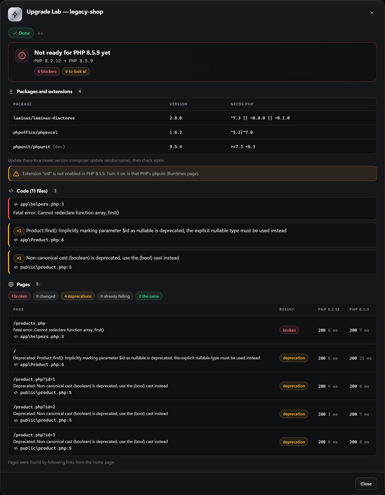

Pick any other installed PHP version. PHP Station tests **your** project on it, without changing a file:

1. **Packages**: every `composer.lock` package whose own `php` constraint leaves the new version out, the `composer.json` constraint, and `ext-*` extensions the new PHP does not load.
2. **Code**: every app file is linted with the new PHP, **deprecations included** (implicit nullable parameters in 8.4, `(boolean)` casts in 8.5 ...).
3. **Pages**: a second, temporary server runs the same folder on the new PHP. Every GET route from `route:list` (or every link of a plain PHP site) opens on **both** versions, and PHP Station compares the status, the PHP errors in the page and what each request wrote to the logs. Pages that sound like they change something (`logout`, `delete`, `reset` ...) are skipped, mail is caught, and a restore point can be saved first. Paste a session cookie to test the pages behind the login too.

The verdict is plain: **ready**, **runs with warnings**, or **not ready yet**, with every file:line one click away in your editor. The screenshot is a real run: a helper named `array_first()` is fine on PHP 8.2 and a fatal error on PHP 8.5, which now has a built-in function with that name.

<details>
<summary><b>See the Upgrade Lab dialog</b></summary>

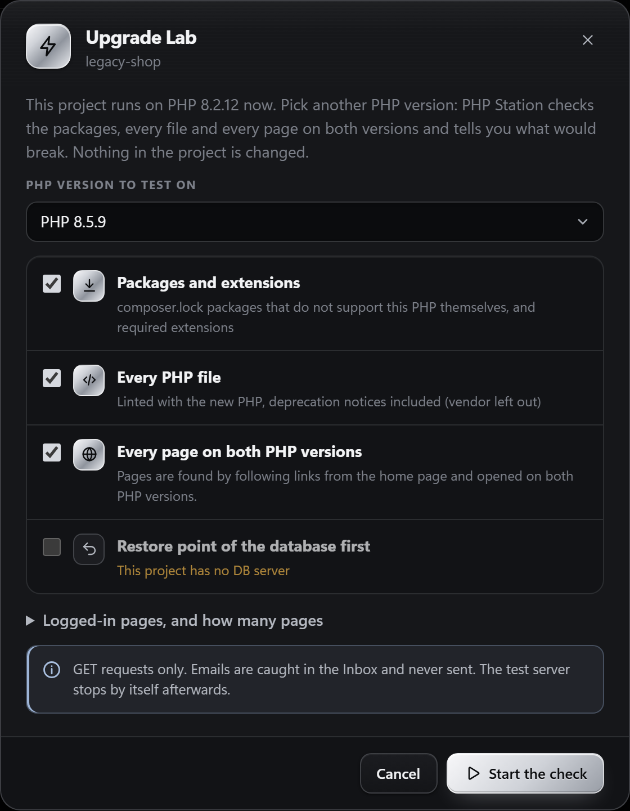
</details>

### 🔐 Security scan before you go live

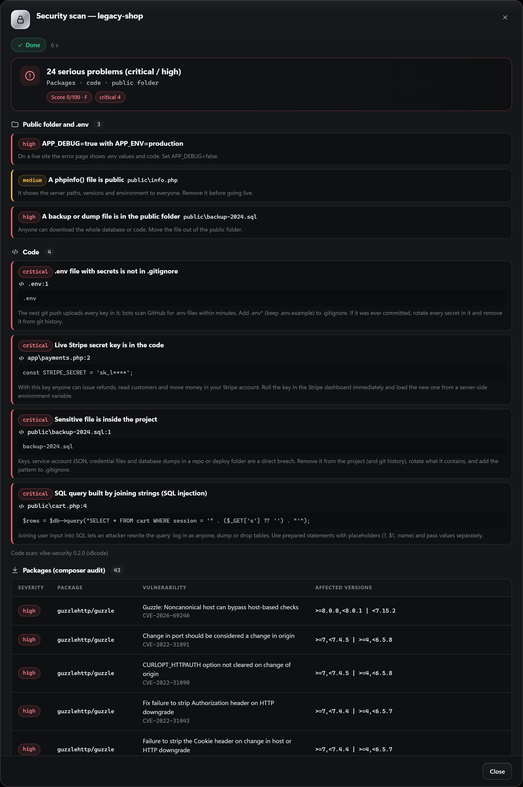

One click on a project card (**⋯ → Security scan**):

- **Public folder and `.env`**: `APP_DEBUG=true` with `APP_ENV=production`, an empty `APP_KEY`, `.env`, `.git`, `phpinfo()` files or `.sql` / `.zip` backups that anyone could download.
- **Code**: [vibe-security](https://github.com/sami-hussain-dev/vibe-security) finds leaked keys (shown masked), SQL injection, XSS, open endpoints and unsafe uploads, each with what to do about it. It runs on this PC; the code goes nowhere.
- **Packages**: `composer audit` lists the known vulnerabilities (CVEs) and abandoned packages in `composer.lock`. This part asks packagist.org, which receives the package names and versions.

### 🕰️ DB Time Machine: undo one query, or the whole day

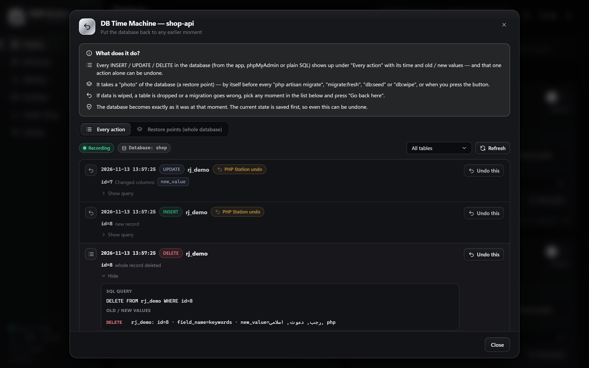

- **Every action.** Every INSERT, UPDATE and DELETE is recorded, whether it came from the app, phpMyAdmin or plain SQL. Each one shows its time, its SQL and the old and new values. **Undo this** reverses only that one action: a deleted row comes back and everything else stays. The undo is recorded too, so it can be undone.
- **Busy days stay readable.** Actions are grouped by hour, and repeats fold into one line (`orders · INSERT × 250`). The counts double as filters, and you can search by `id=21` or by any value.
- **Restore points.** A full copy of the database is saved automatically before `php artisan migrate*` or `db:*`, or by hand. One click goes back. The current state is saved first, and every restore is test-imported into a scratch database before the real one is touched.
- **No waiting in the terminal.** When there is nothing to migrate, or nothing was written since the last restore point, the command starts at once (about 0.1 s) because no new copy is needed.
- **Import any dump.** A `.sql`, `.sql.gz` or `.zip` from MySQL 8, MariaDB, phpMyAdmin or HeidiSQL is checked first. MySQL 8 collations, `DEFINER`s, GTID lines, zero dates, oversized rows, UTF-16 and non-UTF-8 files get their fix switched on before the import starts. If the server still stops, you see its error with the dump line it came from and a **Fix and import again** button. A restore point comes first, so an import can be undone.

<sub>Built on MariaDB's own row-based binary log (10.2+), switched on through command-line flags only. No `my.ini` is edited. The log is kept for 7 days, which you can change.</sub>

### 🚀 Open from GitHub, and team setup in one click

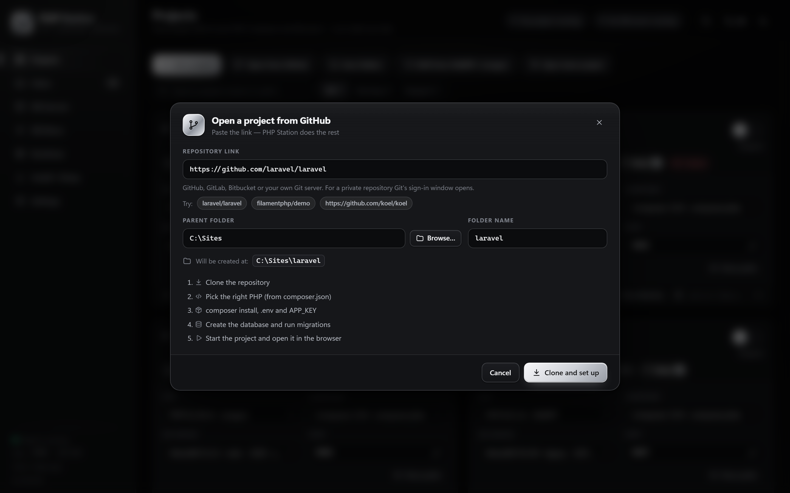

Paste a GitHub, GitLab or Bitbucket link, or just `owner/repo`. PHP Station then:
1. clones the repository;
2. picks the right PHP from `composer.json`;
3. installs anything missing from the official sources;
4. runs `composer install`, creates `.env` and `APP_KEY`, creates the database (MariaDB or SQLite), runs the migrations and `storage:link`;
5. starts the project.

Private repositories use your normal Git sign-in.

Add a **`phpstation.json`** to your repository to pin versions for the whole team:

```json
{
  "$schema": "https://sami-hussain-dev.github.io/PHP-Station/phpstation.schema.json",
  "name": "Shop",
  "php": "8.3",
  "extensions": ["intl", "gd"],
  "database": { "engine": "mariadb", "version": "11.4", "name": "shop_db" },
  "setup": ["env", "composer-install", "key", "database", "migrate", "storage-link"]
}
```

### 🗂️ Projects, side by side

- **Its own PHP, Composer and DB server per project**, running at the same time. PHP Station reads `composer.json`, `composer.lock` and `.env`, detects the Laravel version and **suggests the right PHP** (★).
- **Shift from XAMPP / Laragon in one click.** Your `htdocs` / `www` folders and Apache / nginx virtual hosts are found, and each project keeps the PHP and DB server it used before. Nothing is copied or moved.
- **Fast server.** On Windows, `php -S` handles one request at a time. PHP Station serves static files itself and spreads PHP over 4 workers per project. Pages load all at once instead of one file after another.
- **`.htaccess` without Apache.** For projects without a router of their own (plain PHP, WordPress, CodeIgniter 3 ...), PHP Station applies the `.htaccess` rules most projects use: `RewriteRule` / `RewriteCond` with `-f` / `-d` and back-references, `[L]` `[QSA]` `[R=301]` `[F]` `[G]`, `Redirect` / `RedirectMatch`, `Require all denied` / `Deny from all` and `<FilesMatch>`, `DirectoryIndex`, `ErrorDocument` and `Header set`. `REQUEST_URI` stays what the browser asked for, as under Apache. Lines it cannot apply, such as `php_value`, are listed on the project card.
- **Files menu.** `.env`, the `php.ini` and `my.ini` the project really uses, `laravel.log`, the DB error log, `.htaccess` and the hosts file open in your editor in one click.
- **Live share link with a QR code.** One button gives a running project a public `https://….trycloudflare.com` address, and a QR code to open it on a client's phone in one scan. It uses a Cloudflare quick tunnel: no account, no router settings. The QR code is drawn inside the panel; the link is not sent anywhere to make it.
- **A terminal per project**, where `php` and `composer` are that project's versions. Also: a setup checklist (`.env`, `key:generate`, `composer install`, each `.env` change backed up first), adopting `php artisan serve` servers you started yourself, and "Show paths" with copy buttons.

### 🛡️ Databases that survive Windows

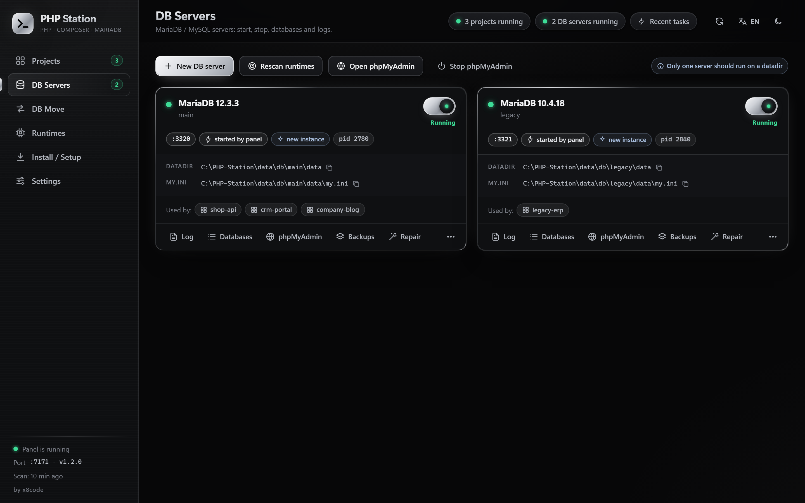

- **Several MariaDB / MySQL servers side by side**, existing XAMPP / Laragon ones included. Create new isolated instances on their own port.
- **Shutdown guard.** Windows waits on shutdown or sign-out until every DB server has stopped cleanly. That is the classic cause of *"MySQL shutdown unexpectedly"*.
- **Snapshots and daily dumps.** The data folder is copied before each start, and every database is dumped to `.sql` once a day.
- **One-click repair** reads the error log and fixes crashed Aria / MyISAM tables and broken system tables. **Rescue data** works on a copy, trying `innodb_force_recovery` 1 → 6.
- **phpMyAdmin built in**, opened straight into a project's database. **DB Move** copies a database between servers and compares row counts.
- Old data is **never deleted or overwritten**. Restores always go into a new folder or database.

### 🧰 Setup wizard and installer

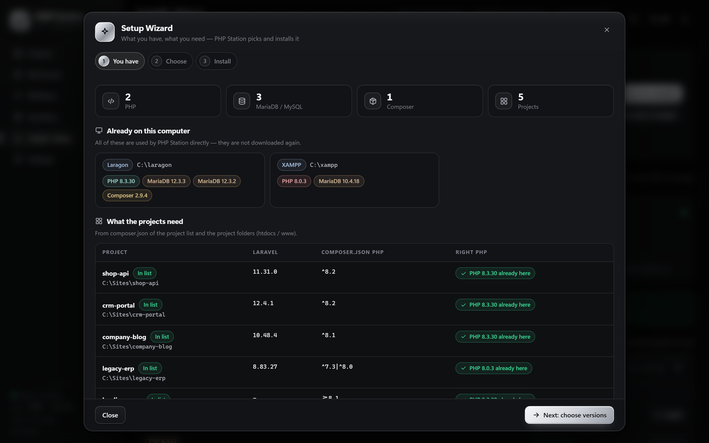

Official sources only: windows.php.net (PHP 7.4 – 8.5), mariadb.org (10.4 – 12.x), getcomposer.org and phpmyadmin.net. Every file is **SHA-256 checked**. No admin rights are needed, and the system PATH is never changed.

### 🔒 Safe by default

- The panel listens on `127.0.0.1` only. It checks `Host` and `Origin`, needs a per-start token for every API call, and sends a strict Content-Security-Policy.
- It only stops processes it has verified itself.
- DB passwords are never stored or logged.
- The Mail Catcher and dump server listen on `127.0.0.1` only and refuse requests from web pages.
- The interface comes in **English, Roman Urdu and Urdu (right-to-left)**, with dark and light themes.

## More screenshots

| | |
|---|---|
| 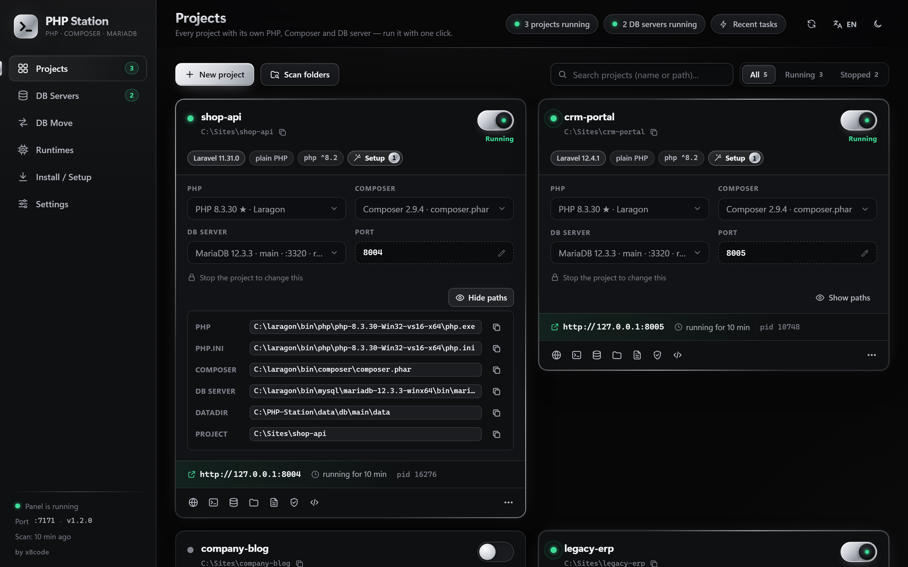 | 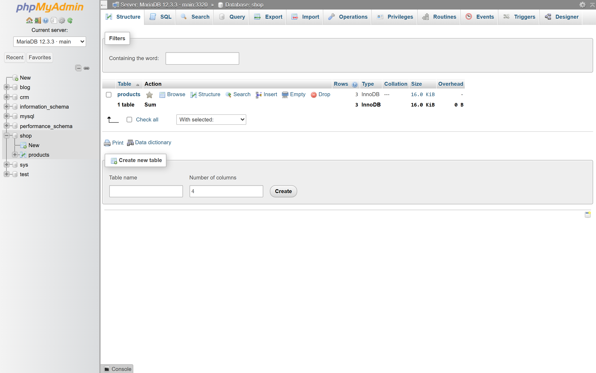 |
| **Show paths**: PHP, php.ini, Composer, DB server, datadir | **phpMyAdmin**: every server on its own port |
| 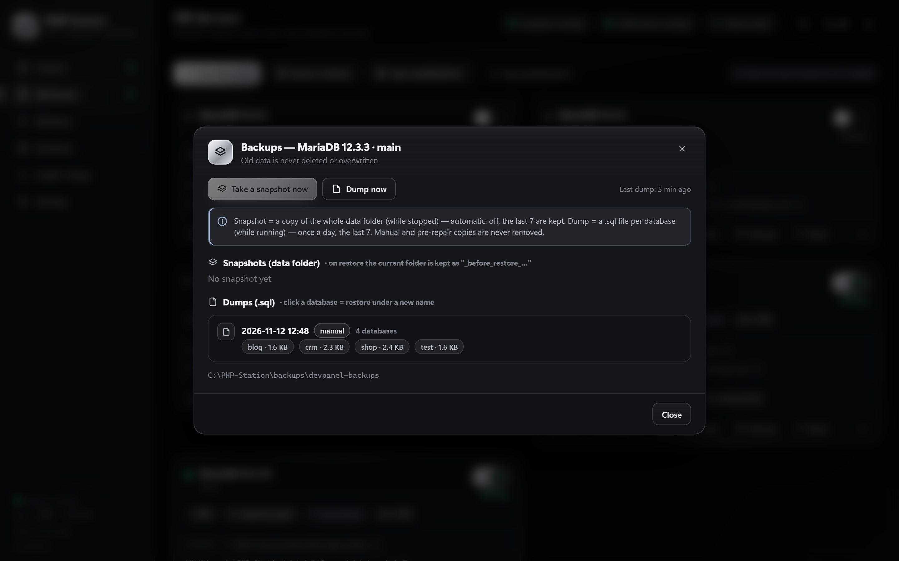 | 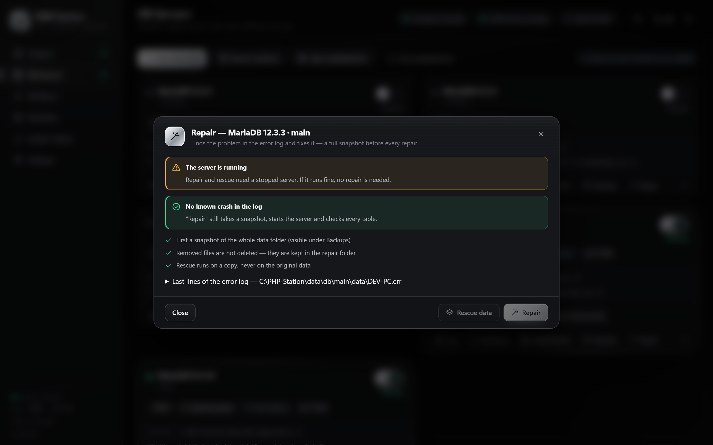 |
| **Backups**: snapshots and daily `.sql` dumps | **Repair**: snapshot first, then fix |
| 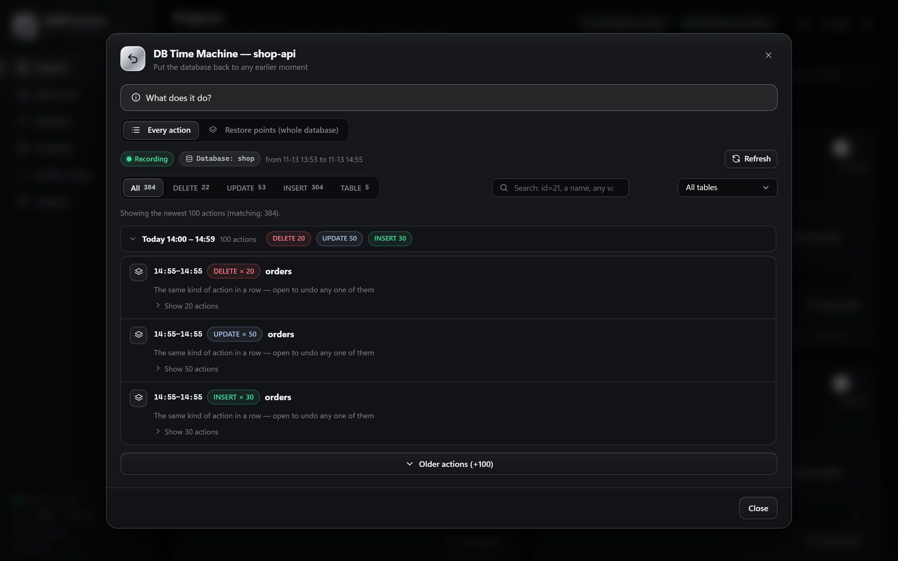 | 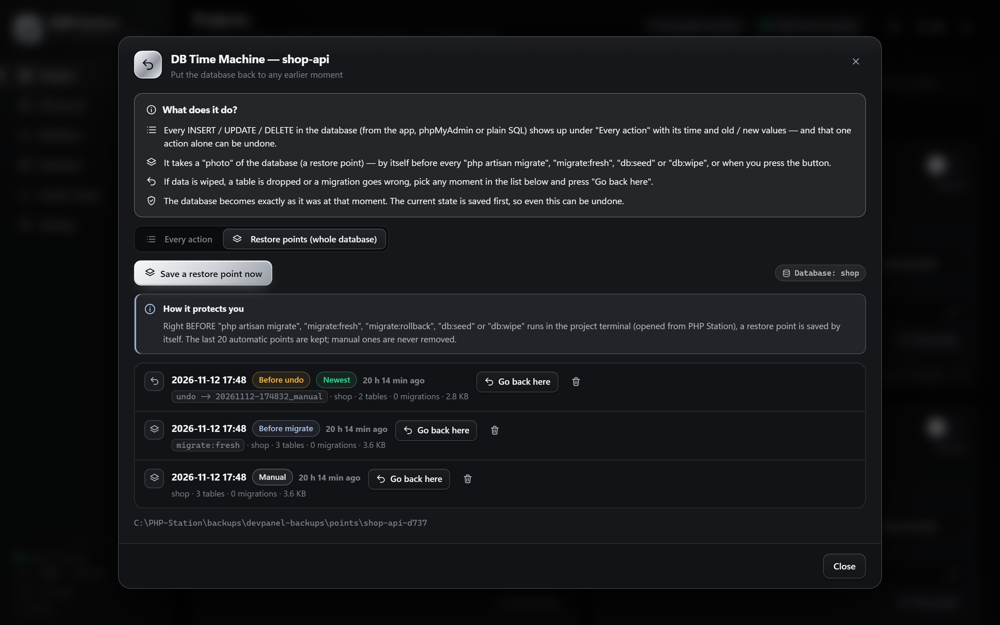 |
| **Busy day**: grouped, folded, filterable | **Restore points**: the whole database, one click back |
| 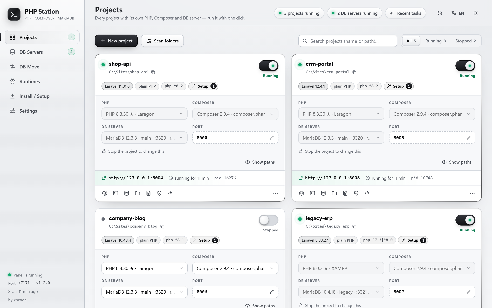 | 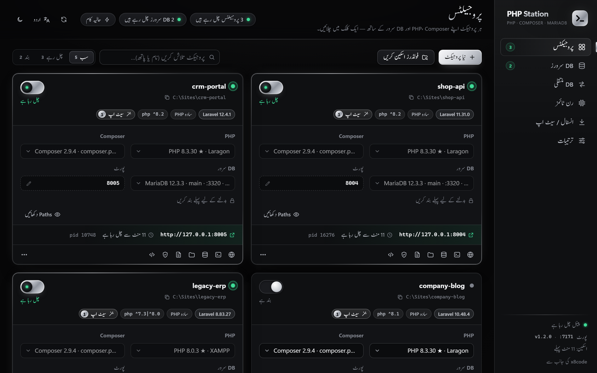 |
| **Light theme** | **Urdu (RTL)** |

## PHP Station vs XAMPP vs Laragon

PHP Station does not throw away what you have: it finds your XAMPP / Laragon installs and uses them, and it can install its own.

| | PHP Station | XAMPP | Laragon |
|---|:---:|:---:|:---:|
| Different PHP version **per project, at the same time** | ✅ | ❌ | ⚠️ one global version |
| Several MariaDB / MySQL servers side by side | ✅ | ❌ | ⚠️ manual |
| `dump()` / `dd()` viewer outside the page | ✅ | ❌ | ❌ |
| Grouped `laravel.log` errors with editor links | ✅ | ❌ | ❌ |
| Undo one INSERT / UPDATE / DELETE | ✅ | ❌ | ❌ |
| Restore points before `migrate:fresh` | ✅ | ❌ | ❌ |
| Paste a GitHub link → running project | ✅ | ❌ | ❌ |
| Clean DB stop on Windows shutdown / sign-out | ✅ | ❌ | ❌ |
| Snapshots, daily `.sql` dumps, one-click repair | ✅ | ❌ | ❌ |
| Public HTTPS link for a client, no account | ✅ | ❌ | ⚠️ ngrok, manual |
| Official downloads with SHA-256 check | ✅ | – | – |
| `.htaccess` rewrites, redirects and access rules | ✅ common rules | ✅ Apache | ✅ Apache |
| Import a MySQL 8 dump into MariaDB, with fixes and undo | ✅ | ❌ | ❌ |
| One-click health check and an issue report without personal details | ✅ | ❌ | ❌ |
| MCP server for AI agents (errors, mail, dumps, DB undo) | ✅ | ❌ | ❌ |
| Free AI chat and "Fix with AI" with diff, check and undo | ✅ | ❌ | ❌ |
| Test a project on another PHP version, page by page | ✅ | ❌ | ❌ |
| Security scan: `composer audit`, code, public folder | ✅ | ❌ | ❌ |
| Size of the tool itself | ~1 MB, zero dependencies | ~150 MB+ | ~100 MB+ |

<sub>Based on the default behaviour of XAMPP and Laragon at the time of writing. If something here is out of date, please open an issue.</sub>

## Requirements

- **Windows 10 or 11** (x64). PHP Station is built on Windows-only parts (the shutdown guard, process control, PowerShell). macOS and Linux are on the roadmap.
- **Databases:** PHP Station starts, guards and backs up **MariaDB and MySQL** servers. Projects that use **SQLite** run as they are, because SQLite is a file. Projects that use **PostgreSQL** run against your own PostgreSQL server; PHP Station does not start it or back it up.
- **Node.js 18+**. `PHP-Station.bat` can fetch a portable copy for you.
- **PHP / MariaDB / Composer**: the ones you already have, or install them with the Setup wizard.
- **Git**, only for *Open from GitHub*.

## FAQ

<details open>
<summary><b>How do I run two Laravel projects with different PHP versions on Windows?</b></summary>

Add both projects, choose a PHP version on each card (for example 8.0 for a Laravel 8 app and 8.3 for a Laravel 12 app), and switch both on. Each one runs with its own `php.exe` on its own port, at the same time.
</details>

<details>
<summary><b>How do I connect Claude Code, Cursor or Copilot to my local Laravel app?</b></summary>

Open **Settings → AI agents**, pick your tool and copy the line or the JSON it shows (Claude Code: `claude mcp add php-station ...`; Cursor: `.cursor\mcp.json`; VS Code: `.vscode\mcp.json`; Codex: `config.toml`). The agent then gets 14 tools: errors, caught mail, dumps, the database history with undo, restore points, start / stop and a health check. It picks the project of the folder it works in.
</details>

<details>
<summary><b>Is the AI really free? Which AI is used?</b></summary>

PHP Station itself costs nothing and has no AI account of its own. On the **AI** page you paste a free key from Google AI Studio (Gemini), Groq, OpenRouter, Mistral, Cerebras or GitHub; each card links to the page that gives it. PHP Station tries them top to bottom and moves to the next one when a free limit is reached. Ollama runs on your own PC with no key and no limit. If you add your own paid key, that account is used first (you can turn that off), and the provider bills you for it.
</details>

<details>
<summary><b>Does "Fix with AI" change my code without asking?</b></summary>

No. It first shows the change as a diff. Only **Apply and check** writes it, after a backup of every file it touches, and then runs `php -l` and opens the page again. A failed check puts the files back. **Undo** restores the backup at any time. `.env`, `vendor` and `storage` are never sent or changed.
</details>

<details>
<summary><b>Will my Laravel / PHP project run on PHP 8.4 or 8.5?</b></summary>

Install the new PHP with the Setup wizard, start the project and choose **⋯ → Upgrade Lab**. It lists the packages that do not support the new PHP, the files that fail or show deprecations, and every page that answers differently on the two versions. Nothing in the project is changed.
</details>

<details>
<summary><b>How do I check my PHP project for vulnerabilities before going live?</b></summary>

**⋯ → Security scan** on the project card. It runs `composer audit` for known CVEs in your packages, [vibe-security](https://github.com/sami-hussain-dev/vibe-security) for leaked keys and injections in your code, and checks the public folder for `.env`, `.git`, `phpinfo()` and backup files.
</details>

<details>
<summary><b>Will my app's emails go to real people while I test?</b></summary>

Not when the project runs in PHP Station with the Mail Catcher on (the default). Every email lands in **Inbox → Mail** and nothing is relayed. One exception: if you ran `php artisan config:cache`, Laravel ignores environment values, so run `php artisan config:clear` first.
</details>

<details>
<summary><b>Where did my <code>dump()</code> output go?</b></summary>

To **Inbox → Dumps**, with the file and line that called it. Turn *Catch dump()* off on that page if you want it in the page again. Dumps from `php artisan` commands always stay in the terminal.
</details>

<details>
<summary><b>I deleted a row or ran <code>migrate:fresh</code> by mistake. Can I get it back?</b></summary>

Yes. A single row change: **Time Machine → Every action → Undo this**. A whole migration: a restore point was saved automatically before it ran (in a PHP Station terminal), so press **Go back here**.
</details>

<details>
<summary><b>How does PHP Station prevent "MySQL shutdown unexpectedly"?</b></summary>

That error usually comes from a DB server killed during Windows shutdown, or from two servers sharing one data folder. The shutdown guard makes Windows wait and stops every server cleanly. PHP Station also refuses a second server on a data folder already in use, and it snapshots the folder before each start.
</details>

<details>
<summary><b>How do I move from XAMPP or Laragon?</b></summary>

Click **Shift from XAMPP / Laragon** on the Projects page, tick the projects and press **Shift selected**. Your XAMPP / Laragon folder is not changed, so you can still open it whenever you like.
</details>

<details>
<summary><b>How do I show my local site to a client?</b></summary>

Start the project and press **Live link**. You get an `https://….trycloudflare.com` address that works on any phone. It ends when you stop it, stop the project or close the panel.
</details>

<details>
<summary><b>Does it need admin rights or change my PATH? Can other computers open it?</b></summary>

No to all three. Everything goes into PHP Station's own folders, the PATH is never changed, and the panel listens on `127.0.0.1` with a per-start token.
</details>

<details>
<summary><b>Where is my data?</b></summary>

`data\` holds settings, logs, caught mail and `.env` backups. `runtimes\` holds installed PHP / MariaDB / Composer. DB backups go to `devpanel-backups\` inside the dump folder you choose in Settings. None of these are committed to git.
</details>

<details>
<summary><b>Does <code>.htaccess</code> work without Apache?</b></summary>

The common rules do. For projects without a router of their own, PHP Station applies rewrites (front controllers, pretty URLs like `product/5` → `product.php?id=5`), redirects, `Require all denied` / `<FilesMatch>` blocks, `DirectoryIndex`, `ErrorDocument` and `Header set`, and a deeper folder's `.htaccess` wins as in Apache. Laravel projects use Laravel's own router, so nothing changes for them. Anything it cannot apply (for example `php_value`, `SetEnv`, `AuthType`) is listed on the project card, with the line number. Put `php_value` settings in `php.ini` instead (**Files → php.ini**). Turn it off in **Settings → .htaccess**.
</details>

<details>
<summary><b>PHP Station is new and made by one developer. What if something breaks?</b></summary>

Press **Doctor** (top right). It checks PHP, projects, database servers, their speed settings, disk space and updates, and shows each problem with its fix. **Copy report** gives a ready-made text for a [GitHub issue](https://github.com/sami-hussain-dev/PHP-Station/issues/new/choose), with your name, PC name and folders masked. The code is MIT-licensed and readable (one file per feature, no build step, more than 250 tests), so anyone can fix or fork it. Your XAMPP / Laragon installs are never changed, so you can always go back to them.
</details>

<details>
<summary><b>Why are imports and migrations slow on my machine?</b></summary>

Usually one of two things, and **Doctor** finds both. XAMPP's MariaDB ships with a 16 MB buffer pool and a 1 MB `max_allowed_packet`; **Apply faster settings** raises them on the running server and in `my.ini` (the old file is kept). Windows Defender also scans every file a database server writes, so each new table takes ~0.3 s; Doctor can exclude just the database folders, after you confirm and Windows asks for administrator permission.
</details>

## How it works

```text
PHP-Station.bat ─> node server.js ─> panel on 127.0.0.1:7070 (token + CSP)
                                      │      ▲
   AI agent ─ stdio ─> node tools\mcp.js ─┘  (same API, same token, this PC only)
                                      │
   ┌──────────────┬───────────────────┼──────────────────┬───────────────┬──────────────┐
   ▼              ▼                   ▼                  ▼               ▼              ▼
 project       mysqld /          Inbox: SMTP :1025   phpMyAdmin     shutdown       installer
 servers       mariadbd          + dump server :9912  (php -S)      guard          (official +
 (own PHP)     (own datadir)     + log reader                                       SHA-256)
```

Small, readable source: `server.js` (HTTP + CLI), `lib/*.js` (one module per feature) and `public/` (a vanilla-JS single page with no framework and no build step). Run `npm test` for the zero-dependency test suite.

<details>
<summary><b>Command line and environment variables</b></summary>

```bash
node server.js --launch            # start (if needed) and open the app window
node server.js --serve [--port N] [--data DIR] [--no-open]
node server.js --stop  [--data DIR]
node tools\mcp.js      [--data DIR]   # MCP server for AI agents (stdio)
npm test
```

| Variable | Meaning |
|---|---|
| `DEVPANEL_DATA` | data folder (default `<install>\data`) |
| `DEVPANEL_NO_SHORTCUTS=1` | do not create shortcuts automatically |
| `DEVPANEL_DB_TESTS=1` | also run the DB integration tests (temporary MariaDB servers on 3391/3392) |
| `PHPSTATION_TEST_XAMPP` | XAMPP folder used by the integration tests (default `C:\xampp`) |
| `DEVPANEL_NET_TESTS=1` | also check the live download sources |

</details>

## Roadmap

- macOS and Linux
- Pretty local domains (`shop.test`) and local HTTPS
- Queue workers and a scheduler per project
- Redis and other services
- "New Laravel project" template

Have an idea? [Open an issue](https://github.com/sami-hussain-dev/PHP-Station/issues/new/choose). If PHP Station saves you time, a ⭐ helps other developers find it.

## Contributing

Bug reports, ideas and pull requests are welcome. See [CONTRIBUTING.md](CONTRIBUTING.md). For security issues, see [SECURITY.md](SECURITY.md).

## Roman Urdu

**PHP Station** Windows ke liye aik local panel hai. Is me kai PHP / Laravel projects aik saath chalte hain, har aik apne PHP version, Composer aur MariaDB ke saath.

- **Chalana:** `PHP-Station.bat` par double-click karein. Setup Wizard batata hai ke kya chahiye, aur official jagah se (SHA-256 check ke saath) install kar deta hai.
- **Inbox:** projects ki har email (OTP, password reset) asli logon ke bajaye panel me aati hai. `dump()` / `dd()` page kharab kiye baghair panel me dikhte hain. `laravel.log` ki errors group ho kar aati hain, aur click karte hi VS Code me wahi line khul jati hai. `.env` bilkul nahi badalti.
- **DB Time Machine:** galti se delete hua record aik click me wapas aa jata hai. `migrate:fresh` se pehle database ki copy khud ban jati hai.
- **GitHub se laayein:** repo ka link paste karein. Clone, sahi PHP, `composer install`, `.env`, database aur migrations sab khud ho jate hain, aur project chal padta hai.
- **XAMPP / Laragon se shift:** aik click, aur purana folder jaisa tha waisa rehta hai.
- **DB hifazat:** Windows band hote waqt DB saaf tareeqe se band hota hai. Roz backup banta hai, aur crash ho jaye to Repair ka aik button hai. Purana data kabhi delete ya overwrite nahi hota.
- **AI agents (MCP):** Claude Code, Cursor, Copilot ya Codex ko jor dein. AI khud errors parhta hai, email se OTP uthata hai, `dump()` dekhta hai, aur `migrate:fresh` se pehle restore point bana leta hai. Settings → AI agents se aik line copy karein.
- **Upgrade Lab:** "Kya mera project PHP 8.5 par chalega?" Project dono PHP versions par saath chalta hai, aur har package, har file aur har page ka muqabla ho kar batata hai ke kya tootega.
- **Security scan:** live karne se pehle packages ki maloom kamzoriyan (`composer audit`), code me leaked keys / SQL injection, aur public folder me `.env`, `.git` ya backup files.
- **Live link ka QR code:** client phone ke camera se scan kare aur site khul jaye.
- **Free AI:** Gemini, Groq, OpenRouter, Mistral wagaira ki apni free keys AI page par dein. Aik ki had khatam ho to agla AI wahin se baat aage barhata hai. Har error ke saath **"AI se theek karein"**: pehle tabdeeli dikhti hai, phir backup, phir lagti hai, phir khud check, aur Undo hamesha mojood. Asli data wale project ko "sirf local AI" (Ollama) par rakh sakte hain.

Tafseeli guide: [PEHLE-YE-PARHEIN.txt](PEHLE-YE-PARHEIN.txt).

## Credits & license

Built by **Sami Hussain**, founder of [x8code](https://x8code.com). Released under the [MIT License](LICENSE).

<sub>Keywords: local PHP development environment for Windows, XAMPP alternative, Laragon alternative, multiple PHP versions on Windows, run Laravel projects side by side, Laravel mail catcher, dump() viewer, laravel.log viewer, undo MySQL delete, MariaDB backup and repair, "MySQL shutdown unexpectedly" fix, clone Laravel project from GitHub, localhost control panel, MCP server for PHP and Laravel, Claude Code Laravel, Cursor MCP local database, upgrade Laravel to PHP 8.5, PHP 8.4 deprecations checker, PHP compatibility check, composer audit GUI, PHP security scanner, Laravel security checklist, free AI for PHP developers, free Gemini Groq OpenRouter in one place, fix Laravel errors with AI, AI code fix with diff and undo, local AI with Ollama for PHP.</sub>
