<div align="center">


# PHP Station

**Run every PHP & Laravel project side by side on Windows, each with its own PHP version, Composer and MariaDB server.**

A free, open-source, zero-dependency local development environment and control panel.
It works as a modern **XAMPP / Laragon alternative** and also uses the XAMPP / Laragon you already have.

[](LICENSE)
[](#requirements)
[](#requirements)
[](package.json)
[](#features)
[](#features)
[](https://github.com/sami-hussain-dev/PHP-Station/actions/workflows/tests.yml)
[](CONTRIBUTING.md)

[Features](#features) · [Screenshots](#screenshots) · [Quick start](#quick-start) · [Compared with XAMPP / Laragon](#php-station-vs-xampp-vs-laragon) · [FAQ](#faq) · [Roman Urdu](#roman-urdu)

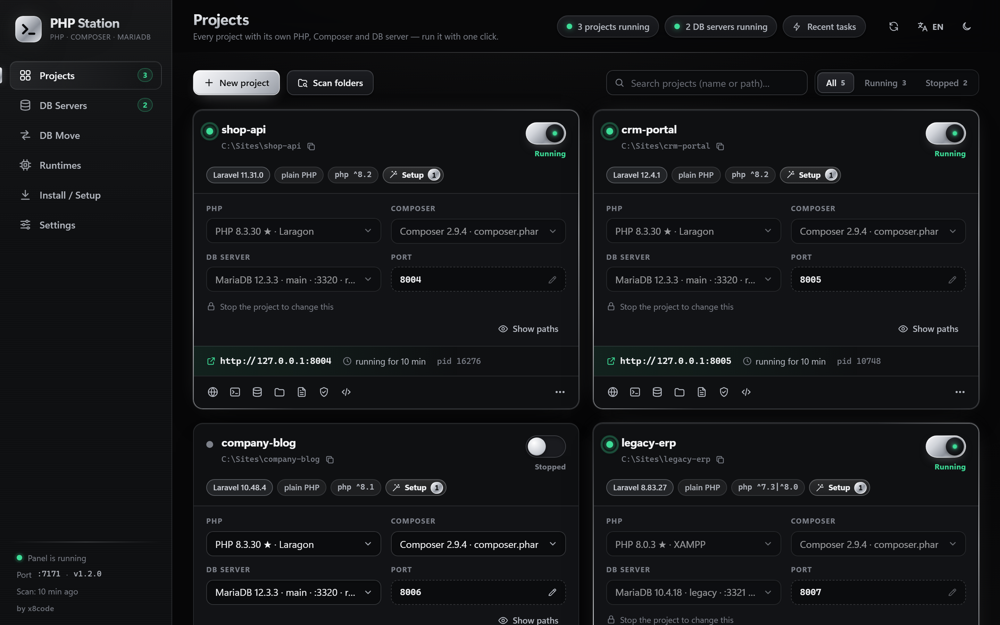

</div>

---

## What is PHP Station?

PHP Station is a **local PHP development environment for Windows**. It runs on your own computer only (`127.0.0.1`).
From one dark/silver control panel you can:

- run **many PHP projects at the same time**, each on its own port;
- give each project **its own PHP version** (for example Laravel 8 on PHP 8.0 next to Laravel 12 on PHP 8.3), its own **Composer** and its own **MariaDB / MySQL server**;
- install PHP, MariaDB, Composer and phpMyAdmin from their **official sources**. Every download is checked with SHA-256, needs no admin rights and does not change the PATH;
- keep your databases **safe from the classic XAMPP crash**. DB servers are stopped cleanly on Windows shutdown, the data folder is snapshotted before every start, a `.sql` dump is taken every day, and a crashed server can be repaired with one click.

It is plain **Node.js with zero npm dependencies**. Nothing needs to be built or installed: double-click `PHP-Station.bat` and it opens.
The interface is available in **English, Roman Urdu and Urdu (RTL)**.

## Features

### Projects
- **Add or scan folders.** PHP Station reads `composer.json`, `composer.lock`, `vendor` and `.env`, detects the Laravel version, and **suggests the right PHP** (★). A warning appears when the chosen PHP does not match the project.
- **One toggle to run or stop a project.** Each project runs on its own port; the port is asked once before the first run and then remembered.
- **Many PHP versions at once.** XAMPP, Laragon, WAMP and PATH installs are found automatically. Copied PHP folders get a relocated `php.ini` copy.
- **A terminal per project.** In it, `php` and `composer` are exactly the versions chosen for that project (`composer install`, `migrate:status`, `optimize:clear`, `tinker` …).
- **Setup checklist.** It creates `.env` from `.env.example`, writes the DB settings and `APP_URL`, runs `composer install` and `php artisan key:generate`. Every `.env` change is backed up first.
- **Missing database on Run.** You can copy it from another server, import a `.sql` file or create it empty. Nothing is ever overwritten.
- **Right DB port without editing `.env`.** If `.env` names a different `DB_PORT`, PHP Station passes the correct port through the environment.
- **External servers.** `php artisan serve` and `php -S` servers you started yourself are shown, and you can adopt or stop them.
- **"Show paths" per project.** Shows the PHP, `php.ini`, Composer, DB server, datadir and project folder, each with a copy button.

### Databases
- **DB servers.** Start and stop (gracefully) any MariaDB / MySQL install, see its logs and databases, and create **new isolated server instances** on their own port.
- **Laragon / XAMPP aware.** If the same data folder is already being served (even by an elevated Laragon), that server is used instead of starting a second one.
- **phpMyAdmin built in.** PHP Station runs its own copy, with every DB server listed on its own port, and can open it straight into a project's database. It is installed from phpmyadmin.net or copied from XAMPP / Laragon.
- **DB Move.** Moves a database from an old server to a new one (dump, import, then row counts compared table by table).

### Crash-safe by design
- **Shutdown guard.** A tiny helper (`PHPStationGuard.exe`) makes Windows wait on shutdown, restart or sign-out, and sends every DB server its clean-shutdown signal. This prevents the most common cause of *"MySQL shutdown unexpectedly"* in XAMPP.
- **Automatic snapshots.** A full copy of a stopped server's data folder is taken before PHP Station starts it (daily or always, kept as the last *N* copies, with a size limit).
- **Daily dumps.** A `.sql` file of every database of each running server is made once a day.
- **One-click repair.** It reads the error log (crashed Aria/MyISAM tables, broken privilege tables, Aria log, *"log sequence number is in the future"*, tables missing in the engine, port or lock problems), takes a snapshot, and then repairs: `aria_chk` / `myisamchk`, system tables rebuilt from a clean template, then `mariadb-check --auto-repair`.
- **Rescue data.** For InnoDB damage it works on a copy, never on the original data. It tries `innodb_force_recovery` 1 → 6, dumps everything, and can import the result into a fresh server.
- **Old data is never deleted or overwritten.** Restores keep the current folder as `…_before_restore_<time>`, and dumps are restored only into a **new** database.

### Setup wizard and installer
- **Setup wizard.** Shows what is already on the computer, works out what your projects need, and suggests what to install (**Auto select**). It then installs everything in one batch.
- **Official sources only.** windows.php.net (PHP 7.4 – 8.5), mariadb.org (including LTS and end-of-life 10.4 / 10.5), getcomposer.org and phpmyadmin.net. Every file is checked with SHA-256. Everything goes into PHP Station's own `runtimes` folder.
- **Shortcuts.** On the first start, a **Desktop and Start Menu shortcut** is created automatically.

### Safety of the panel itself
- It listens on `127.0.0.1` only, checks `Host` / `Origin`, needs a per-start token for every API call, and sends a strict Content-Security-Policy.
- It only stops processes it has verified itself. Other programs are never touched.
- DB passwords are never stored or logged; they reach MySQL / MariaDB tools only through `MYSQL_PWD`.

## Screenshots

| | |
|---|---|
|  | 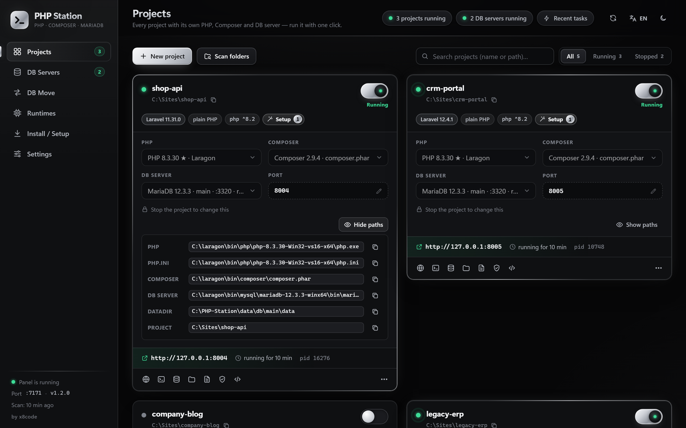 |
| **Projects**: one card per project, each with its own PHP, Composer, DB server and port | **Show paths**: every path of a project, each with a copy button |
| 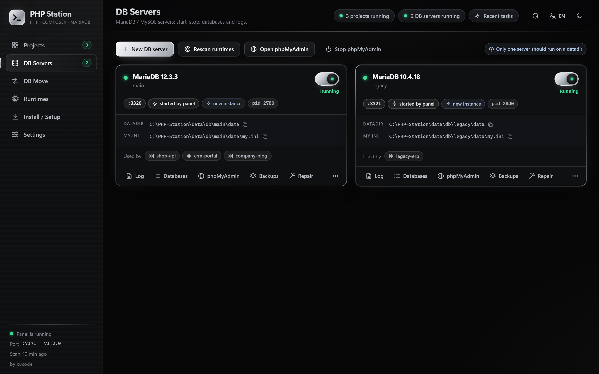 | 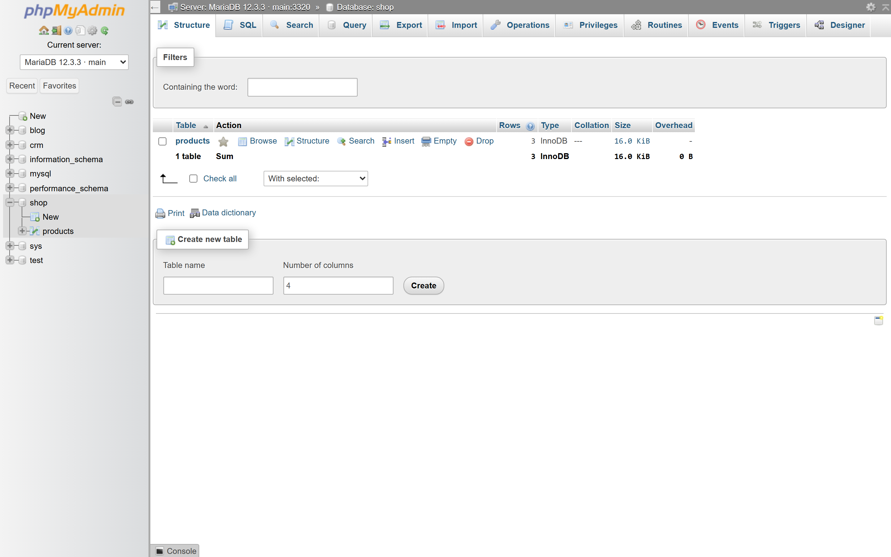 |
| **DB Servers**: MariaDB 12.3 and 10.4 running side by side | **phpMyAdmin**: built in, every server on its own port |
| 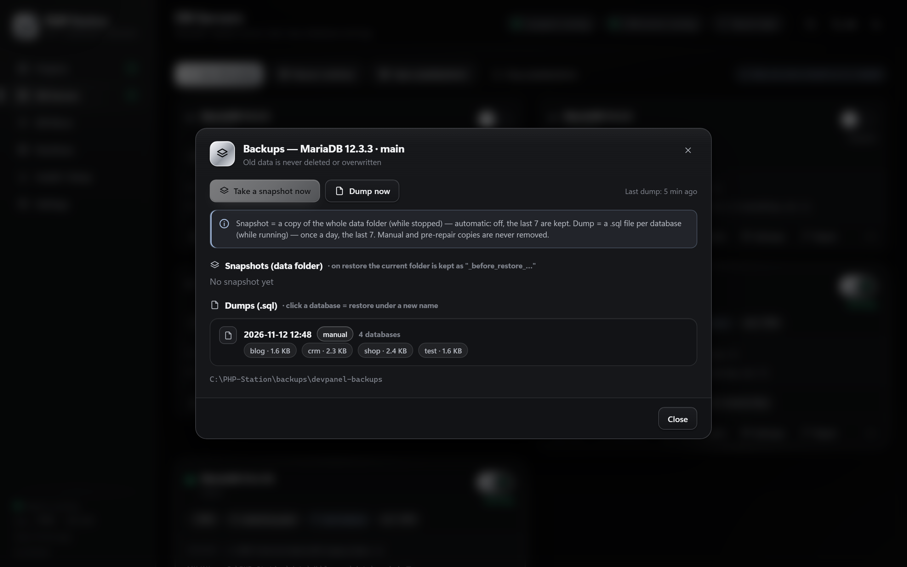 | 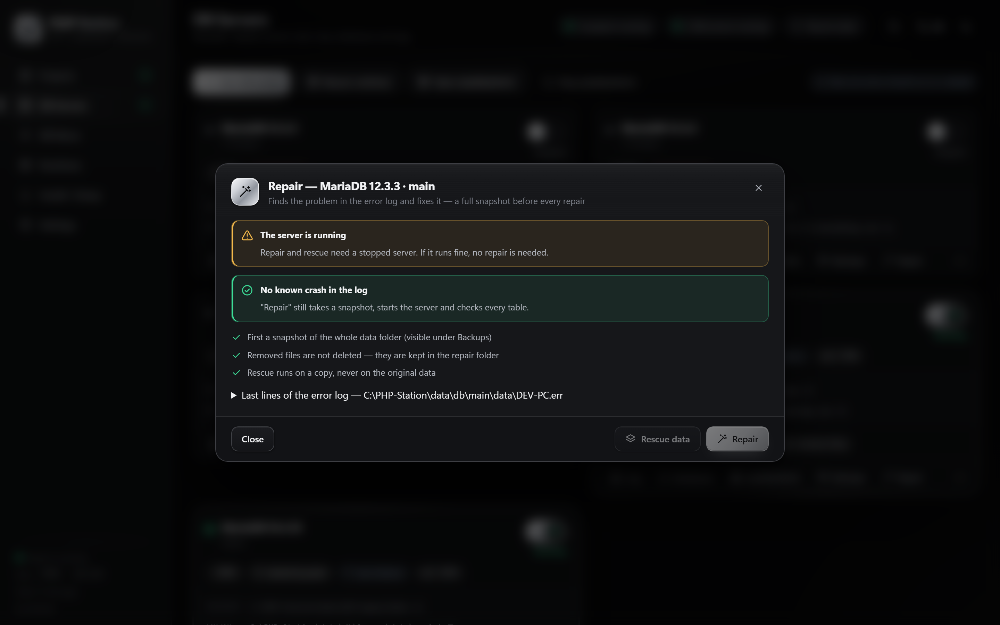 |
| **Backups**: snapshots and daily `.sql` dumps | **Repair**: reads the error log, snapshot first, then fixes it |
| 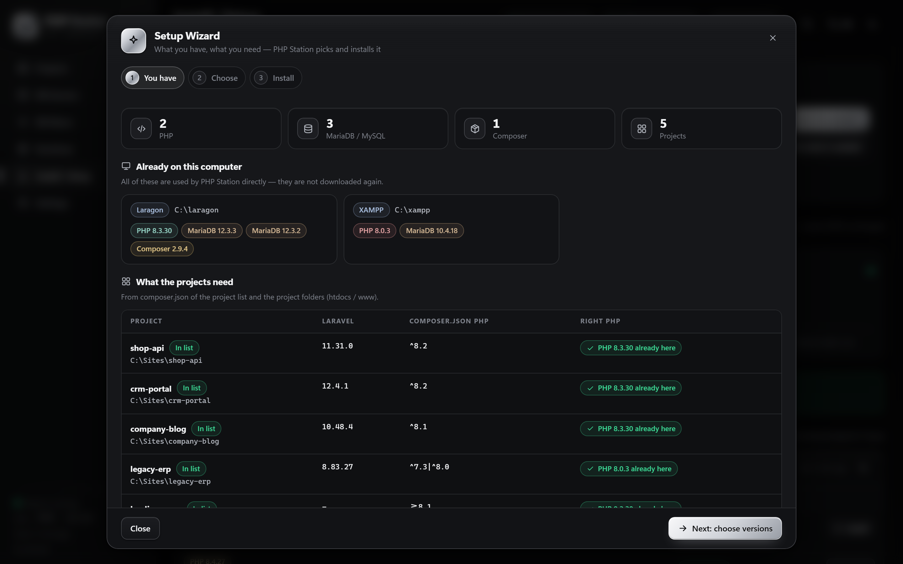 | 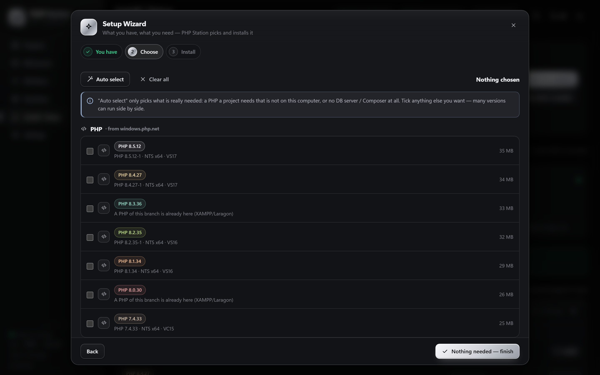 |
| **Setup wizard**: what you have and what your projects need | **Choose versions**: auto select, then install everything in one batch |
| 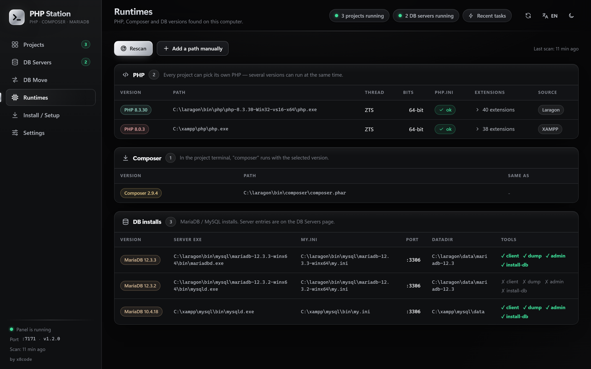 | 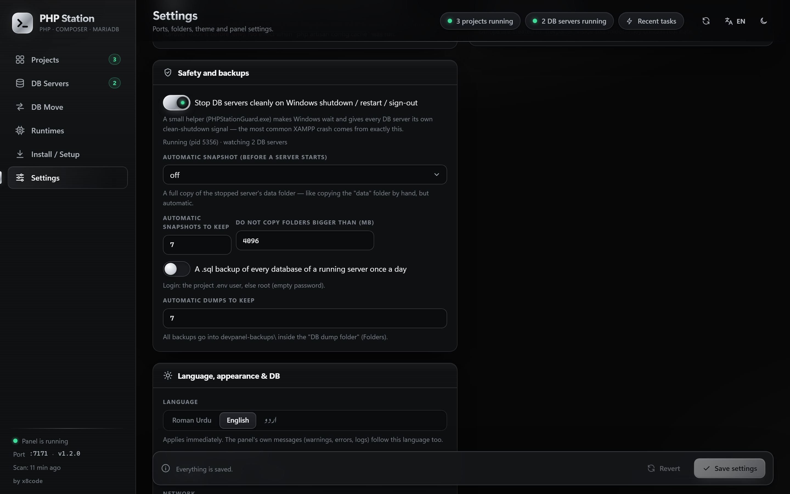 |
| **Runtimes**: everything found on this computer | **Safety settings**: guard, snapshots, dumps |
| 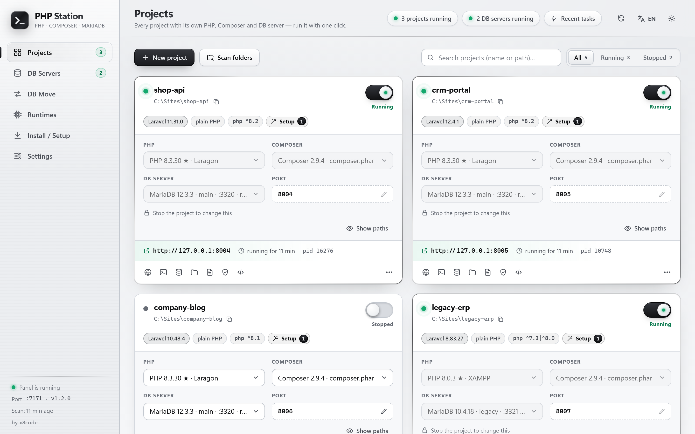 | 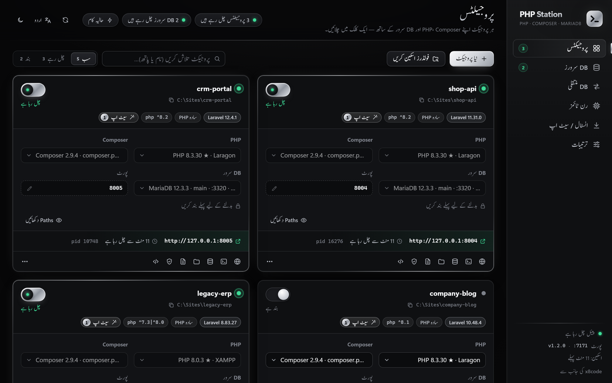 |
| **Light theme** | **Urdu (RTL)**, plus English and Roman Urdu |

## Quick start

1. **Download** this repository (green *Code* button → *Download ZIP*) or clone it:
   ```bash
   git clone https://github.com/sami-hussain-dev/PHP-Station.git
   ```
2. **Double-click `PHP-Station.bat`.** The panel opens as an app window at `http://127.0.0.1:7070/`. If port 7070 is busy, the next free port is used.
   A Desktop and Start Menu shortcut is created on the first start.
3. If no PHP / MariaDB is installed yet, the **Setup wizard** opens and installs what your projects need.
4. Click **+ New project** or **Scan folders**, check the suggested PHP, and switch the project on.

To stop only the panel, run `PHP-Station-Stop.bat` (or use *Settings*). Projects and DB servers keep running.

<details>
<summary><b>Command line</b></summary>

```bash
node server.js --launch            # start (if needed) and open the app window
node server.js --serve [--port N] [--data DIR] [--no-open]
node server.js --stop  [--data DIR]
npm test                           # zero-dependency test suite (node --test)
```

| Environment variable | Meaning |
|---|---|
| `DEVPANEL_DATA` | data folder (default `<install>\data`) |
| `DEVPANEL_NO_SHORTCUTS=1` | do not create the Desktop / Start Menu shortcuts automatically |
| `DEVPANEL_DB_TESTS=1` | also run the DB integration tests (temporary MariaDB servers on ports 3391/3392) |
| `PHPSTATION_TEST_XAMPP` | XAMPP folder used by the integration tests (default `C:\xampp`) |
| `DEVPANEL_NET_TESTS=1` | also check the live download sources (index files and HEAD requests only) |

</details>

## Requirements

- **Windows 10 or 11** (x64).
- **Node.js 18 or newer.** If it is missing, `PHP-Station.bat` offers to download the portable Node.js LTS from nodejs.org into `runtimes\node` (SHA-256 verified, no admin rights).
- **PHP / MariaDB / Composer.** Use the ones you already have (XAMPP, Laragon, WAMP …) or install them with the Setup wizard.

## PHP Station vs XAMPP vs Laragon

PHP Station does not replace your existing installs. It finds them and uses them, and it can also install its own.

| | PHP Station | XAMPP | Laragon |
|---|:---:|:---:|:---:|
| Different PHP version **per project, at the same time** | ✅ | ❌ one PHP per install | ⚠️ one global version, switched |
| Several MariaDB / MySQL servers side by side | ✅ | ❌ | ⚠️ manual |
| Suggests the right PHP from `composer.json` / Laravel | ✅ | ❌ | ❌ |
| Clean DB stop on Windows shutdown / sign-out | ✅ shutdown guard | ❌ | ❌ |
| Automatic data-folder snapshots + daily `.sql` dumps | ✅ | ❌ | ❌ |
| One-click DB repair from the error log | ✅ | ❌ | ❌ |
| Official downloads with SHA-256 check | ✅ | – | – |
| Uses existing XAMPP / Laragon installs | ✅ | – | – |
| Size of the tool itself | ~1 MB of code, zero dependencies | ~150 MB+ | ~100 MB+ |

<sub>Based on the default behaviour of XAMPP and Laragon at the time of writing. If something here is out of date, please open an issue.</sub>

## FAQ

<details open>
<summary><b>How do I run two Laravel projects with different PHP versions on Windows?</b></summary>

Add both projects to PHP Station and choose a PHP version on each card, for example PHP 8.0 for a Laravel 8 app and PHP 8.3 for a Laravel 12 app. Switch both on. Each project runs with its own `php.exe` on its own port, at the same time. Nothing is switched globally.
</details>

<details>
<summary><b>Is PHP Station a replacement for XAMPP or Laragon?</b></summary>

It can be. It installs PHP, MariaDB, Composer and phpMyAdmin by itself. It also works on top of an existing XAMPP or Laragon: their PHP versions and DB servers appear automatically and can be used per project.
</details>

<details>
<summary><b>How does PHP Station prevent "MySQL shutdown unexpectedly" in XAMPP?</b></summary>

That error usually comes from a DB server that was killed during Windows shutdown or sign-out, or from two servers using the same data folder. PHP Station's shutdown guard makes Windows wait and stops every DB server cleanly. It also refuses to start a second server on a data folder that is in use, and it takes a snapshot of the data folder before each start.
</details>

<details>
<summary><b>How do I repair a crashed MariaDB / MySQL database?</b></summary>

Open **DB Servers → Repair** on the server's card. PHP Station reads the error log and names the problem. Then, after a full snapshot, it repairs the crashed Aria / MyISAM tables, rebuilds broken system tables from a clean template and checks every table. For InnoDB damage, use **Rescue data**: it works on a copy of the data folder, never on the original.
</details>

<details>
<summary><b>Does PHP Station need admin rights or change my PATH?</b></summary>

No. Everything it installs goes into its own `runtimes` folder, and the system PATH is never changed.
</details>

<details>
<summary><b>Is it safe? Can other computers open the panel?</b></summary>

No other computer can open it. The panel listens on `127.0.0.1` only, checks `Host` and `Origin`, and needs a random per-start token for every API call. DB passwords are never stored or logged.
</details>

<details>
<summary><b>Which PHP and MariaDB versions are supported?</b></summary>

PHP 7.4 – 8.5 (from windows.php.net) and MariaDB 10.4 – 12.x (from mariadb.org). Any PHP / MariaDB / MySQL already on the computer can be used too. MySQL itself is not downloaded, because Oracle's site blocks automated downloads and publishes no SHA-256 for the zip. MariaDB is a drop-in replacement for Laravel's `mysql` driver.
</details>

<details>
<summary><b>Where is my data?</b></summary>

- **Settings, project list, logs, `.env` backups:** `data\` inside the PHP Station folder.
- **Installed runtimes:** `runtimes\`.
- **DB backups:** `devpanel-backups\` inside the *DB dump folder* you choose in Settings.

None of these are committed to git.
</details>

## How it works

```text
PHP-Station.bat ──> node server.js --launch ──> local HTTP panel on 127.0.0.1:7070 (token + CSP)
                                                  │
           ┌──────────────────────┬───────────────┼──────────────────────┬────────────────────┐
           ▼                      ▼               ▼                      ▼                    ▼
   php -S per project      mysqld / mariadbd   phpMyAdmin (php -S)   PHPStationGuard.exe   installer
   (own php.exe + port)    (own datadir+port)  one entry per server  (clean DB shutdown)   (official + SHA-256)
```

The source is small and readable: `server.js` (HTTP + CLI), `lib/*.js` (projects, runtimes, DB servers, backups, repair, installer, wizard, phpMyAdmin, guard), and `public/` (a vanilla-JS single page; no framework, no build step).

## Roadmap

- Pretty local domains (`shop.test`) and local HTTPS
- Queue workers and a scheduler per project
- Local mail catcher
- Redis and Node.js services
- "New Laravel project" template

Have an idea? [Open an issue](https://github.com/sami-hussain-dev/PHP-Station/issues/new/choose).

## Contributing

Bug reports, ideas and pull requests are welcome. See [CONTRIBUTING.md](CONTRIBUTING.md). Security issues: see [SECURITY.md](SECURITY.md).

## Roman Urdu

**PHP Station** Windows ke liye aik local control panel hai jis se aap kai PHP / Laravel projects aik sath chala sakte hain. Har project apne PHP version, apne Composer aur apne MariaDB/MySQL server ke sath chalta hai.

- **Chalana:** `PHP-Station.bat` par double-click karein. Pehli dafa Desktop aur Start Menu me shortcut khud ban jata hai. Node.js na ho to PHP Station poochta hai aur portable Node khud `runtimes\node` me rakh deta hai.
- **Setup Wizard:** batata hai ke computer par kya hai aur projects ko kya chahiye, phir PHP, MariaDB, Composer aur phpMyAdmin official jagah se (SHA-256 check ke sath) install kar deta hai.
- **DB hifazat:** Windows band hote waqt DB servers saaf tareeqe se band hote hain. Server start hone se pehle data folder ki copy banti hai, aur roz `.sql` dump banta hai. Crash ho jaye to "Repair" ka aik button hai.
- **phpMyAdmin:** har DB server apne port ke sath aik jagah.
- **Kabhi overwrite nahi:** purana data kabhi delete ya overwrite nahi hota.

Tafseeli guide: [PEHLE-YE-PARHEIN.txt](PEHLE-YE-PARHEIN.txt).

## Credits & license

Built by **Sami Hussain**, founder of [x8code](https://x8code.com).
Released under the [MIT License](LICENSE).

<sub>Keywords: local PHP development environment for Windows, XAMPP alternative, Laragon alternative, WAMP alternative, multiple PHP versions on Windows, run Laravel projects side by side, PHP version manager for Windows, MariaDB manager, phpMyAdmin, MySQL crash repair, "MySQL shutdown unexpectedly" fix, automatic database backup, Composer per project, localhost control panel.</sub>
